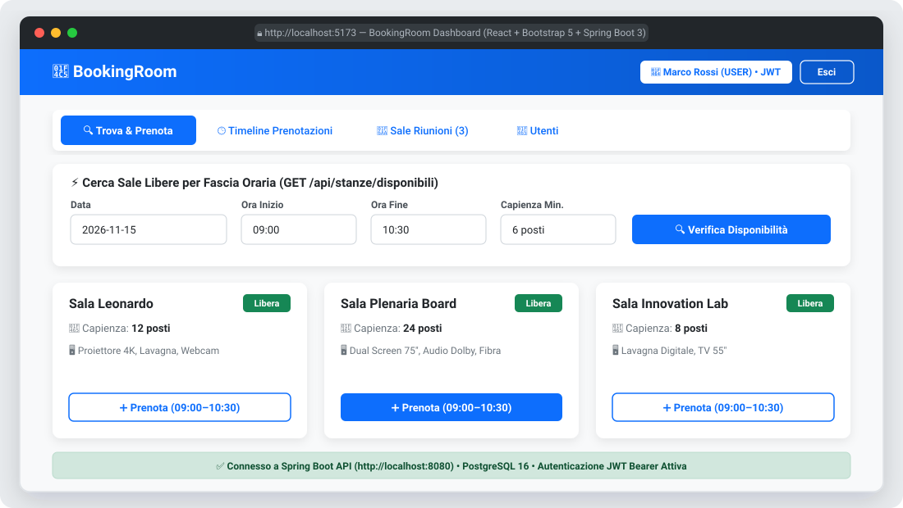

# BookingRoom Frontend (`bookingRoomFE`)


Single Page Application (SPA) reattiva sviluppata con **React 18**, **Vite** e **Bootstrap 5** per la gestione delle sale riunioni e delle prenotazioni aziendali, collegata al backend Spring Boot **[BookingRoom API (`bookingroom`)](https://github.com/simonesici/bookingroom)**.

---

## Anteprima Interfaccia (UI Mockup)



---

## Caratteristiche Principali

- **Trova & Prenota Rapido (`/api/stanze/disponibili`)**:
  - Ricerca istantanea delle sale riunioni libere filtrando per **Data**, **Ora Inizio**, **Ora Fine** e **Capienza Minima**.
  - Card Bootstrap con badge di stato (`Libera`), capienza, dotazioni tecniche e pulsante **Prenota con 1 click**.
- **Timeline Prenotazioni (`/api/prenotazioni/timeline/{anno}/{mese}`)**:
  - Vista tabellare filtrabile per **Anno**, **Mese** o **Singola Stanza** (`/api/prenotazioni/stanza/{id}`), con cancellazione immediata.
- **Gestione Sale Riunioni (`/api/stanze`)**:
  - Anagrafica sale riunioni con filtro in tempo reale per capienza minima, form di creazione (`nome`, `capienza`, `descrizione`) ed eliminazione.
- **Autenticazione JWT & Gestione Utenti (`/api/auth/login`, `/api/auth/me`, `/api/utenti`)**:
  - Modale di login Bootstrap che salva il token **JWT Bearer** in `localStorage` e lo allega automaticamente a tutte le richieste protette (`POST`, `PUT`, `DELETE`).
  - Gestione utenti con assegnazione ruoli (`USER` / `ADMIN`).

---

## Stack Tecnologico

| Componente | Tecnologia |
| :--- | :--- |
| **Libreria UI** | React 18 (Hooks: `useState`, `useEffect`, `useCallback`) |
| **Build Tool & Dev Server** | Vite 5 (HMR + Proxy `/api` verso `http://localhost:8080`) |
| **Design & Componenti** | Bootstrap 5.3 + Bootstrap Icons |
| **Comunicazione API** | Fetch API nativa con interceptor JWT (`src/services/api.js`) |

---

## Struttura del Progetto

```text
bookingRoomFE/
├── docs/
│   └── mockup.svg             # Mockup vettoriale della dashboard
├── index.html                 # Entry point HTML5
├── package.json               # Dipendenze e script npm (dev, build, preview)
├── vite.config.js             # Configurazione Vite e proxy /api -> localhost:8080
└── src/
    ├── main.jsx               # Bootstrap dell'app React e import stili Bootstrap 5
    ├── App.jsx                # Componente principale con Navbar, 4 Tab e Modale Login
    └── services/
        └── api.js             # Client REST centralizzato con gestione JWT e errori JSON
```

---

## Avvio Rapido in Sviluppo

1. Assicurati che il backend Spring Boot (`bookingroom`) sia attivo su `http://localhost:8080`.
2. Installa le dipendenze npm:
   ```bash
   npm install
   ```
3. Avvia il server di sviluppo Vite:
   ```bash
   npm run dev
   ```
4. Apri nel browser: **[http://localhost:5173](http://localhost:5173)**
   *(Credenziali di bootstrap predefinite per il login: `admin` / `admin`)*.

---

## Build per la Produzione

Per compilare l'applicazione in un pacchetto statico ottimizzato (generato nella cartella `dist/`):

```bash
npm run build
```
